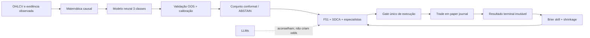

# SuperEzio — modernização da verdade preditiva (2026-07-19)

## Conclusão executiva

O SuperEzio não é, e o código não deve alegar ser, um oráculo de mercado. Após esta
intervenção, ele é um organismo adaptativo **fail-closed**: matemática determinística
mede o que os dados permitem; um modelo direcional só publica probabilidades depois de
validação temporal fora da amostra; módulos de crise recusam inferência sem os insumos
econômicos exigidos; LLMs permanecem conselheiros; e ordens autônomas exigem evidência
neural qualificada, calibrada, atual, rastreável e não ambígua.

O ganho central não é uma promessa de lucro. É a remoção de falsas certezas e a criação
de um ciclo verificável entre previsão ex-ante, resultado terminal e ajuste de
confiabilidade.

## Estado anterior confirmado

| Superfície | Problema real anterior | Risco |
|---|---|---|
| NeuralDecisionExpert | Probabilidades/retorno codificados por heurística | Ordem baseada em odds inexistentes |
| Technical Neural | Split aleatório e scaler contaminado pelo futuro | Leakage temporal |
| Neural RL | Rede aleatória votava BUY/SELL com zero episódios e estado fabricado | Pseudoaprendizado ativo |
| F51 | Score heurístico apresentado como confiança/probabilidade; veracidade podia se autoconfirmar | Falsa certeza |
| RSI/MACD | RSI olhava a série completa; signal MACD não era EMA9 genuína | Indicadores não causais |
| Quantum | Simulação sem qualquer entrada de mercado | Ruído aleatório apresentado como evidência |
| HRP | Cap redistribuído de forma que podia violar a própria restrição | Risco de concentração |
| Crise | Ausência de dados podia virar normal/verde; proxies inadequados para SRISK/contágio | Falso negativo sistêmico |
| Outcomes | Peso de especialista não conhecia a direção prevista e o reward saturava | Crédito causal incorreto |

## Decisão Neural depois da correção

Implementação principal: `src/experts/technical_neural/expert/neural_expert.py`.

- Candles são validados, ordenados e deduplicados. Duplicatas conflitantes são erro.
- Features usam apenas prefixos observados: retornos logarítmicos, range, volatilidade,
  distância da média e volume. Não há feature de sentimento inventada.
- O alvo é `DOWN / SIDEWAYS / UP` em horizonte explícito.
- O split é cronológico em treino, validação, calibração conformal e teste, com gaps do
  tamanho do horizonte para impedir sobreposição do alvo.
- O `StandardScaler` é ajustado somente no treino.
- A MLP é determinística e precisa superar a climatologia de treino em Brier,
  log-loss e balanced accuracy tanto no gate de validação quanto no teste OOS.
- Temperature scaling usa a janela de validação. A janela seguinte, ainda intocada,
  produz scores split-conformal de probabilidade inversa.
- Uma probabilidade pode ser publicada como `ready`, mas execução exige que o conjunto
  conformal contenha **exatamente uma classe** compatível com o lado da ordem.
- Modelo sem skill, classes incompletas, menos de 140 amostras rotuladas (cerca de 161
  candles brutos), candle stale, artefato corrupto ou simplex inválido retorna `ABSTAIN`.
- Artefatos são JSON + NPZ sem pickle, escritos atomicamente, com SHA-256, `model_id`,
  versão, `as_of`, horizonte, input hash e métricas OOS. Restart deve reproduzir a mesma
  distribuição.

O antigo `NeuralDecisionExpert` agora é apenas copiloto de integridade/risco. Suas
features são calculadas de candles observados; ausência de evidência de segurança gera
veto. Ele nunca cria distribuição direcional.

### Por que não foi instalado um foundation model no caminho ativo

Em julho de 2026, TimesFM 2.5 oferece contexto longo e cabeça quantílica, e Chronos-2
oferece forecasting zero-shot multivariado/covariável. Eles são candidatos legítimos a
**challengers**, não prova automática de skill em retornos financeiros. Sem artefato
local, benchmark por ativo, custo/latência medidos e validação OOS contra climatologia,
colocá-los no caminho ativo apenas trocaria uma alegação por outra. Referências:

- [TimesFM oficial — atualização de 2 de julho de 2026](https://github.com/google-research/timesfm)
- [Chronos-2 oficial](https://github.com/amazon-science/chronos-forecasting)
- [TimeSeriesSplit — scikit-learn](https://scikit-learn.org/stable/modules/generated/sklearn.model_selection.TimeSeriesSplit.html)
- [Calibração de probabilidades — scikit-learn](https://scikit-learn.org/stable/modules/calibration.html)
- [Adaptive Conformal Inference — NeurIPS](https://proceedings.neurips.cc/paper/2021/hash/0d441de75945e5acbc865406fc9a2559-Abstract.html)

## Matemática e portfólio

- RSI: Wilder causal e prefix-invariant.
- MACD: EMA12 menos EMA26, signal EMA9 real e histograma consistente.
- Cenários: stationary block bootstrap de Politis–Romano sobre retornos realmente
  observados; não é chamado de quantum e não produz previsão sem série.
- HRP: covariance shrinkage Ledoit–Wolf, single linkage, quasi-diagonalização e
  bisseção recursiva. Excesso do cap fica em caixa em vez de ser redistribuído de volta.
- Datas: backtest de penny exige timestamps reais; datas sintéticas foram removidas.
- MathHub: publica estimativas determinísticas com cobertura/status. O prompt não as
  chama mais de `GROUND TRUTH` nem chama o score F51 de probabilidade.

Referências de implementação:

- [Ledoit–Wolf — scikit-learn](https://scikit-learn.org/stable/modules/generated/sklearn.covariance.LedoitWolf.html)
- [Hierarchical linkage — SciPy](https://docs.scipy.org/doc/scipy/reference/generated/scipy.cluster.hierarchy.linkage.html)

## Sensores de crise

Implementação: `src/experts/crisis/models/`.

- Regime: HMM Gaussiano de dois estados, EM determinístico e posterior filtrado causal.
- Hawkes: processo exponencial ajustado por máxima verossimilhança, impondo estabilidade
  `alpha / beta < 1`.
- Growth-at-Risk: quantil com pinball loss e validação rolling; não é mais expectile
  rotulado como quantil.
- LPPLS: forma completa `A/B/C1/C2`, otimização não linear, múltiplas janelas e filtros.
- SRISK, CoVaR e DebtRank/contágio retornam `insufficient_data` quando faltam balanços,
  capitalização, liabilities/exposures ou séries bancárias reais. Não usam preço isolado
  como substituto silencioso.
- Ausência de macro nunca vira regime normal/verde.
- Heurísticas remanescentes têm `method_kind`, amostra, horizonte, `as_of` e status de
  calibração explícitos.

Referências:

- [Markov switching / Hamilton filter — statsmodels](https://www.statsmodels.org/stable/generated/statsmodels.tsa.regime_switching.markov_regression.MarkovRegression.html)
- [Requisitos conceituais do SRISK — NYU V-Lab](https://vlab.stern.nyu.edu/docs/srisk)

## F51, execução e ausência de dados

- `decision_score` F51 é `uncalibrated_decision_score`, não `P(success)`.
- Um módulo não pode confirmar a própria afirmação; evidência independente é obrigatória.
- Defaults fabricados de retorno, volume, revenue, risco e probabilidades foram removidos.
- O caminho antigo de quantum foi retirado do DataHub. A API de compatibilidade retorna
  `status=removed`, sem números.
- Um ticker sozinho não gera baseline de 50%; gera `insufficient_data`.
- Paper order e adaptador IBKR compartilham o mesmo gate neural: `ready`, calibrado,
  `model_id`, `as_of`, horizonte, simplex válido, direção compatível e conjunto conformal
  unitário. Qualquer ausência bloqueia.

## Aprendizado do organismo

Implementação: `src/core/trading/outcome_learning.py`.

- Somente trade terminal com ID, entrada/saída, lado, quantidades, custos e forecast
  ex-ante entra no ledger SQLite transacional.
- Replays idênticos são idempotentes; o mesmo ID com outro payload é conflito.
- Cada especialista precisa ter direção e probabilidades coerentes. Confiança sem direção
  não recebe crédito.
- O realizado é a direção do ativo após custos/deadband, não apenas `win/loss` do lado da
  posição.
- Confiabilidade usa Brier multiclasses contra climatologia uniforme, com shrinkage por
  amostra e pesos limitados a `[0.5, 2.0]` antes da normalização.
- Reward de PnL é retorno percentual com `tanh`, portanto não depende do tamanho nominal.
- Probabilidade neural só recebe crédito se for calibrada, tiver proveniência e estiver
  alinhada ao lado lucrativo.
- A política pseudo-RL aleatória foi aposentada. Sua compatibilidade só responde `WAIT`;
  tentativa de update sem trajetória durável falha explicitamente.

Isto implementa autoajuste de ligações, mas de forma conservadora: com pouca história o
shrinkage mantém os pesos perto dos priors. Não existe “dopamina” técnica que justifique
aumentar risco após ganho; performance melhora confiabilidade, enquanto limites de
execução continuam independentes e restritivos.

## Evidência de verificação

Executado no workspace real em 2026-07-19:

- `python -m ruff check src/ tests/` — passou.
- `python -m pytest tests/ -q` — **1532 passed, 11 skipped, 0 failed** em 113.22 s.
- `python scripts/browser_smoke.py --base-url http://127.0.0.1:8002 --skip-chat` —
  passou com health 200, AAPL com 124 candles, canvas 685×640 não vazio e zero erros de
  console.
- Screenshot: `output/playwright/superezio-browser-smoke-20260719-172141.png`.

Também existem testes específicos para causalidade de prefixo, scaler train-only, gaps,
simplex, baseline skill, conformal, restart idêntico, corrupção, staleness, veto,
atribuição direcional, idempotência e bloqueio no broker.

## Limites honestos que permanecem

1. **Não há histórico real suficiente no relatório para afirmar alpha ou lucro live.** O
   mecanismo agora sabe recusar; sua vantagem precisa emergir em prequential/paper data.
2. **Os Parquets do MacroDataset não existem no workspace.** Sensores que dependem deles
   permanecerão indisponíveis, como devem.
3. **SRISK/CoVaR/DebtRank precisam de dados institucionais reais.** Não foram substituídos
   por proxies cosméticos.
4. **Drift de runtime:** ambiente ativo usa NumPy 2.4.6, mas `pyproject.toml` exige `<2.3`
   e `uv.lock` fixa 2.2.6; scikit-learn ativo é 1.9.0 contra lock 1.8.0; statsmodels 0.14.6
   está no lock mas ausente. A suíte passa, porém o ambiente não é reprodução do lock.
5. **CEO/GGUF local continua indisponível no smoke.** MAN_AT_WORK bloqueou ordens como
   projetado. Isso não invalida os núcleos matemático/neural, mas impede validação do LLM
   local completo.
6. **Credenciais ficaram fora do escopo e não foram tocadas.**

## Próximo experimento correto

Executar uma janela paper prequential por ativo e horizonte, registrando toda previsão
antes do resultado. Promover challenger somente quando superar climatologia e campeão em
Brier/log-loss, manter cobertura conformal próxima do alvo, sobreviver a custos e mostrar
estabilidade por regime. TimesFM/Chronos podem entrar nessa arena como challengers, nunca
como atalhos para o gate.
