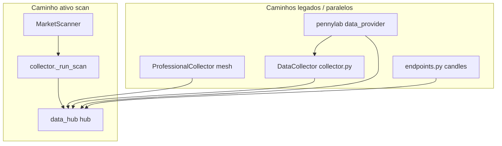

# Arqueologia — duplicações e redundâncias (ROOT SuperEzio)

**Data:** 2026-05-22  
**Escopo:** `C:\Users\marco\Desktop\SuperEzio` (raiz do projeto)  
**Método:** Varredura read-only (imports, `graph.py`, coletores, experts, testes, `.f51`)  
**Referência anterior:** `.f51/DUPLICATE_MAP.md` (2026-05-21) — **parcialmente desatualizado**

---

## Resumo em uma frase

O runtime **ativo** é pipeline v4 (`orchestrator → data → agent ↔ tools`), mas ainda existem **CEO legado**, **nós v3 exportados sem aresta**, **três pilhas de preço** e **docs que descrevem a pipeline antiga**.

---

## Tier P0 — duplicata real / risco alto

| ID | O quê duplica o quê | Evidência | Ação sugerida |
|----|---------------------|-----------|---------------|
| **P0-1** | **Dois CEOs:** `ceo.py` (~607 lin) vs `agent.py` (~610 lin) | `node_ceo` não está no `graph.py`; grafo usa só `agent` | **Arquivar/apagar** `src/core/pipeline/nodes/ceo.py`; migrar `tests/contracts/test_contract_ceo.py` |
| **P0-2** | **Pipeline v3 vs v4:** nós F51/RAG/experts/SDCA exportados, grafo linear só 4 nós | `nodes/__init__.py` exporta `node_ceo`, `route_after_f51`; `graph.py` não liga `run_expert`, `rag_forensics` | **Documentar v4**; marcar `@deprecated` ou remover rotas `Send` mortas; `respond_blocked` sem entrada |
| **P0-3** | **Import quebrado** subprocess collector | `collector.py` L207: `from ...data_collector.subprocess_collector` — arquivo **não existe**; real: `src/adapters/data_collector/subprocess_collector.py` | **Corrigir path** ou remover fallback |
| **P0-4** | **Três pilhas de preço** | `data_hub.py` + `professional.py` (mesh próprio + `_fetch_hub_price`) + `data_collector/collector.py` (hub + scraper + QuantEngine) + `pennylab/data_provider.py` | **Preço canônico = DataHub**; Professional só orquestra |
| **P0-5** | **README/contrato ≠ runtime** | `README.md` e `.f51/contracts/pipeline.contract.md` descrevem fan-out F51→CEO; real = ReAct em `agent` + `tool_executor` | **Atualizar** docs para v4 |
| **P0-6** | **neural_decision vs technical_neural** | Dois sinais: regras/heurísticas (`neural_decision_expert`) vs PyTorch MLP (`technical_neural`) usado pelo `DataCollector` legado | **Unificar produto** ou arquivar `technical_neural` |
| **P0-7** | **signal_ledger** paths mortos | Testes apontam `scripts/signal_ledger`; código em `scripts/_archive/signal_ledger/` | Atualizar testes/docs |
| **P0-8** | **`_node_pennylab_stub`** em `graph.py` | Função definida, **não** registrada em `build_graph()` | Apagar ou mover para tool |

---

## Tier P1 — overlap intencional mas caro

| ID | Tema | Paths principais | Ação |
|----|------|------------------|------|
| **P1-1** | Intent/prompt triplicado | `intents.py`, `orchestrator.py`, `agent.py`, `core/pipeline/prompts/builder.py`, `_prompts.py` | Uma fonte de rota + um builder de prompt CEO |
| **P1-2** | Market scan em 3 camadas | `collector._run_scan`, `scanner/__init__.py`, `agent._market_scan_answer` | Manter scanner + formatação no agent |
| **P1-3** | API HTTP bypassa nó `data` | `agent_server/endpoints.py` chama `hub` direto | Delegar ao mesmo serviço do collector |
| **P1-4** | Neural REST + tool | `endpoints.py` + `tool_executor` | Um entrypoint, outro wrapper |
| **P1-5** | Brokers duplos (OK) | `core/trading/broker.py` vs `adapters/broker/ibkr_adapter.py` | Manter; unificar atrás de port se crescer |
| **P1-6** | `load_local_env` em N lugares | `secrets.py`, `data_hub`, `collector` node, `professional`, `main` | Só no bootstrap `main.py` |
| **P1-7** | Shim `collect_experts` | `nodes/collect_experts.py` → `experts.node_collect_experts` | Delete quando imports legados sumirem |
| **P1-8** | Testes F51 duplicados | `test_components_f51.py` vs `test_contract_f51_engine.py` | Consolidar em `tests/f51/` |
| **P1-9** | Professional reimplementa preço | `professional._fetch_twelve_data_price`, `_fetch_hub_price` vs hub registry | Professional = cache/batch apenas |
| **P1-10** | Twelve + Alpha no Professional **e** no Hub | Mesmas APIs, prioridades diferentes | Hub manda; Professional não bypassa |

---

## Tier P2 — disco / docs / cache (não duplicata lógica)

| ID | Item | Tamanho / nota | Ação |
|----|------|----------------|------|
| **P2-1** | Checkpoints duplos | `runtime/checkpoints/` vs `.f51/checkpoints/` | Manter com nomes claros (ops vs sessão F51) |
| **P2-2** | Logs | `runtime/logs/` (~38 arquivos); `output/` e2e/playwright — **sem** `output/server/` (stale no DUPLICATE_MAP) | Limpar `output/*.log` antigos |
| **P2-3** | Artefatos pesados | `.f51/tmp/` ~8.1 GB; `data/fraud_datasets/` ~3.3 GB; `data/corpus/` deprecated | Apagar quando precisar de disco |
| **P2-4** | `scripts/__pycache__/` | .pyc de scripts apagados | Apagar pasta |
| **P2-5** | Mapas F51 stale | `DUPLICATE_MAP`, `ENTRYPOINT_MAP`, `TEST_MAP` | Atualizar após limpeza P0 |
| **P2-6** | README vs DELIVERY | Propósitos diferentes; README pipeline desatualizado | README = runtime; DELIVERY = release notes |
| **P2-7** | Smoke scripts vs pytest | `smoke_datahub_price.py`, `smoke_twelve_data.py` | Manter para debug manual |
| **P2-8** | `scripts/_archive/` | Ledger e utilitários antigos | Não reexportar em testes |

---

## O que **não** é duplicata (F51 estava certo)

- **Ports/adapters:** `DataCollectorPort` + `SubprocessCollector` em `adapters/` — padrão correto.
- **Providers no Hub:** finnhub / twelve / yfinance / stooq — **fallback por prioridade**, não cópia.
- **collector vs scraper vs professional** — API vs scrape vs mesh (complementares, mas P0-4 é sobre **preço** repetido).

---

## Grafo ativo (referência)

```
START → orchestrator_primary → data → agent ⇄ tool_executor
                              ↘ explanation (condicional)
```

Experts, F51, RAG, PennyLab, SDCA: **somente** via tools em `tool_executor.py`.

---

## Prioridade de limpeza (ordem sugerida)

1. P0-5 — alinhar README + `.f51/contracts/pipeline.contract.md` ao v4  
2. P0-3 — corrigir import `subprocess_collector`  
3. P0-1 — arquivar `ceo.py`  
4. P0-2 — podar nós/rotas órfãos (`respond_blocked`, `Send` em `f51.py`)  
5. P0-4 — contrato único de preço via DataHub  
6. P0-6 — decisão neural_decision vs technical_neural  
7. P2 — limpeza de logs/cache/`.f51/tmp`  

---

## Diagrama de sobreposição (preço)



---

*Gerado por auditoria arqueológica read-only. Nenhum arquivo de produção foi alterado neste passo.*
